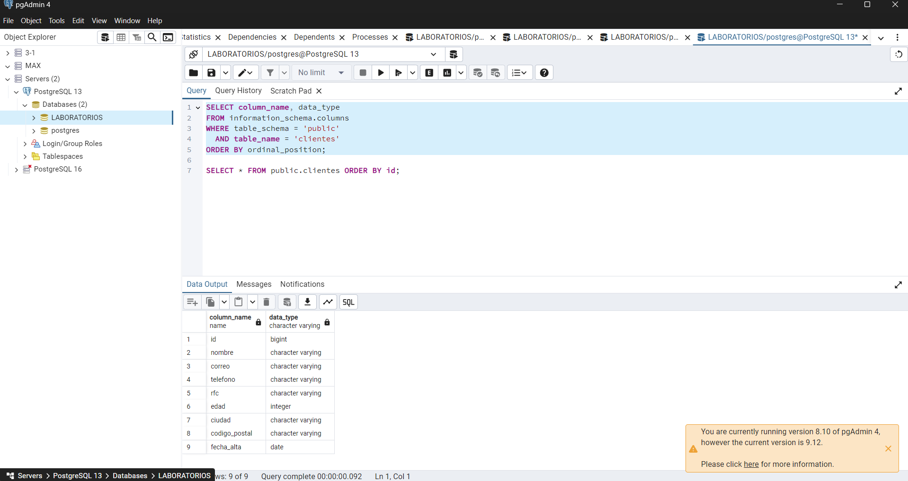
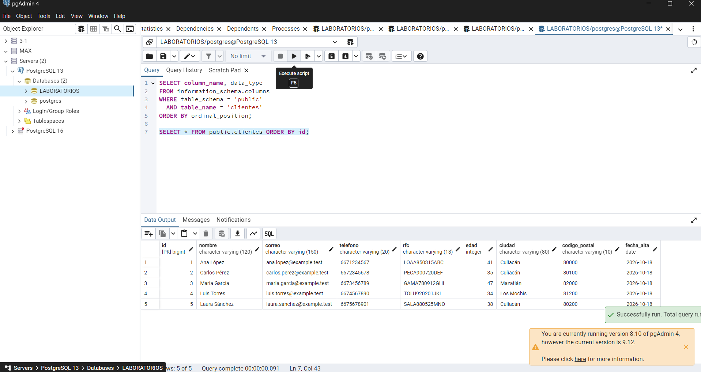

Evidencia 01 — Inventario de datos

## Objetivo
En esta actividad revisé los datos que aparecen en la tabla de clientes para identificar cuáles son personales, para qué sirven y quién debería tener acceso.

## Procedimiento
Tomé cada campo del escenario y pensé si hacía falta para atención al cliente, facturación o analítica. Los tiempos de retención son una propuesta para el ejercicio; la empresa tendría que revisarlos con las áreas correspondientes antes de aplicarlos.

## Resultado

| Campo | ¿Es dato personal? | ¿Para qué se usaría? | ¿Es necesario? | ¿Quién lo necesita? | Retención propuesta |
|---|---|---|---|---|---|
| id | Sí, porque permite relacionar el registro con una persona | Identificar registros | Sí, para operar la base | Atención autorizada y DBA según su función | Mientras el registro siga siendo necesario |
| nombre | Sí | Atención y facturación | Sí para esas actividades | Atención y facturación | Mientras se necesite para la relación y las obligaciones aplicables |
| correo | Sí | Contactar al cliente | Sí para atención por correo | Atención; marketing solo si se aprueba esa finalidad | Mientras sea necesario para el contacto autorizado |
| telefono | Sí | Contactar al cliente | Solo si se usa ese medio | Atención | Mientras sea necesario |
| rfc | Sí, identifica a una persona | Facturación | No para soporte general; sí puede hacer falta para facturar | Facturación | Por el plazo que se justifique para obligaciones fiscales y operativas |
| edad | Sí | Estadísticas por rangos | No hace falta para soporte general; analítica puede usar rangos | Analítica con datos agregados | La edad exacta solo mientras sea necesaria |
| ciudad | Puede identificar al combinarse con otros datos | Servicio y estadísticas | Depende del servicio | Atención cuando haga falta y analítica en forma agregada | Mientras sea necesaria para el servicio; luego se puede conservar en forma agregada |
| codigo_postal | Sí, sobre todo al combinarlo con otros datos | Entregas o región para estadísticas | El código completo no siempre hace falta | Operaciones si lo necesita; analítica con una región general | Conservar el detalle solo mientras sea necesario |
| fecha_alta | Sí, porque está ligada al registro | Revisar cuándo comenzó la relación | Sí para algunos procesos | Áreas que administran la relación y DBA con control | Según el plazo que la empresa justifique |

## Análisis
Al hacer la tabla noté que no todos los campos tienen que estar disponibles para todas las áreas. Por ejemplo, soporte puede trabajar con nombre, correo y teléfono, pero no necesita consultar el RFC. Para analítica es mejor usar conteos y rangos en vez de mostrar los datos completos de cada persona.

## Conclusión
El inventario ayuda a saber para qué se usa cada dato y quién lo necesita. Antes de conservar un campo o darle acceso a un área, la empresa debería justificarlo y definir por cuánto tiempo lo va a guardar.

