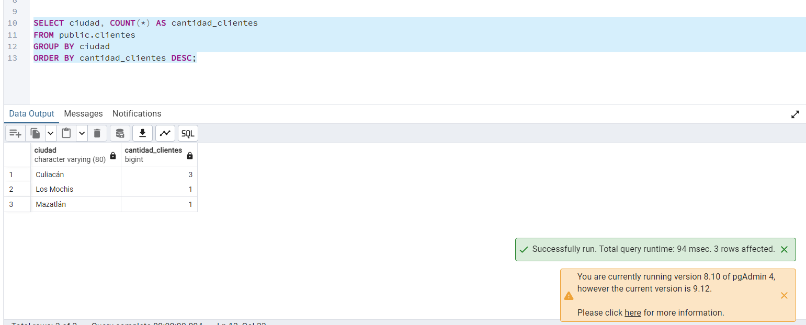

Evidencia 05 — Uso de datos para promociones

## Objetivo
Revisé si la empresa puede usar los datos de sus clientes para mandar promociones personalizadas.

## Procedimiento
Comparé el uso original de los datos para atención o facturación con el nuevo uso que propone marketing. Después anoté qué tendría que revisar la empresa y qué controles se podrían aplicar.

## Análisis y respuestas

1. **¿Tener los datos significa que se pueden usar para cualquier cosa?**  
   No. Que los datos estén guardados no quiere decir automáticamente que se puedan usar para una finalidad nueva. La empresa tendría que revisar qué informó a los clientes, si el nuevo uso es compatible y qué autorización o fundamento corresponde.

2. **¿Qué debería preguntarse la empresa?**  
   Debería aclarar para qué será la campaña, qué datos necesita, a quiénes incluirá, cuánto durará, si se informó esta finalidad y cómo podrá una persona pedir que no se usen sus datos para promociones. También tendría que revisar si participarán proveedores externos.

3. **¿Qué datos hacen falta?**  
   Solo los necesarios para la campaña aprobada. Tal vez basten grupos generales por ciudad o rango de edad. El RFC y la dirección completa no parecen necesarios para enviar promociones.

4. **¿Marketing necesita entrar directamente a la tabla de clientes?**  
   No necesariamente. Se le podría dar una lista limitada o preparar un segmento con los datos permitidos, sin entregar la tabla completa.

5. **¿Qué controles técnicos ayudarían?**  
   Se pueden usar vistas con menos columnas, roles con permisos limitados, listas de exclusión para quien no quiera promociones, registros de acceso y límites a las exportaciones.

## Conclusión
Antes de usar la información para una finalidad secundaria, la empresa tendría que revisarla y aprobarla. La base de datos puede limitar lo que consulta cada área, pero la decisión sobre el uso debe tomarse con las áreas responsables.

