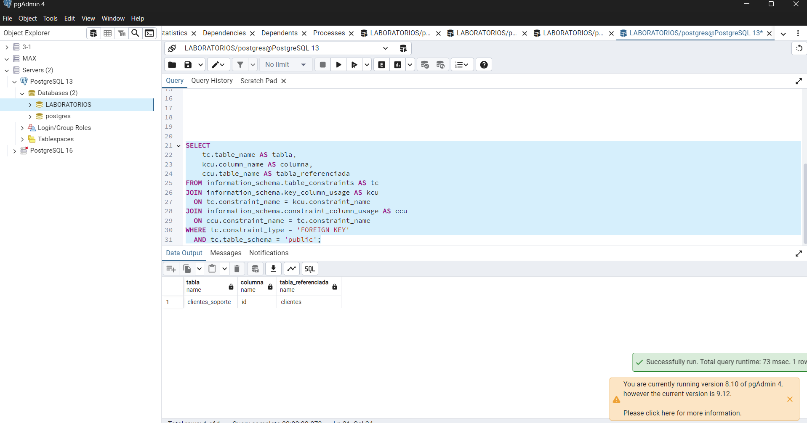

# Evidencia 08 — Ciclo de vida de los datos

## Objetivo
En esta actividad revisé qué otros lugares podrían tener copias de los datos de un cliente, además de la tabla principal.

## Procedimiento
Hice un mapa de los sistemas y archivos que podrían guardar copias. No ejecuté ningún `DELETE`, porque la instrucción pide analizar primero el ciclo de vida.

## Resultado

```text
Solicitud autorizada
        │
        ▼
Tabla principal de clientes
   ├── respaldos
   ├── réplicas
   ├── reportes y analítica
   ├── archivos exportados
   ├── copias de desarrollo y pruebas
   └── sistemas externos o proveedores
```

## Análisis
Borrar un registro de la tabla principal no necesariamente borra sus copias. Puede seguir apareciendo en respaldos, reportes, archivos descargados, bases de prueba o sistemas externos. Por eso primero hay que identificar dónde está la información y coordinar las acciones con las áreas responsables.

## Conclusión
Para atender una cancelación no basta con borrar una fila de la base de datos. Hay que revisar todo el recorrido de la información y seguir las instrucciones aprobadas por la organización. El DBA puede ayudar a encontrar y modificar los datos, pero no debe decidir por sí solo el alcance de la solicitud.


