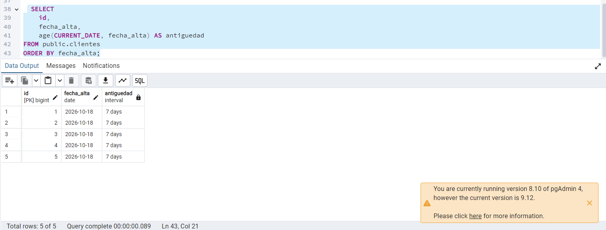

Evidencia 10 — Retención de datos

## Objetivo
Analicé la propuesta de conservar todos los datos de clientes para siempre “por si acaso”.

## Procedimiento
Revisé qué problemas puede causar conservar información sin un plazo y qué puntos tendría que definir la empresa en una política de retención.

## Resultado y respuestas

1. **¿Es compatible con la minimización?**  
   No parece compatible, porque se guardarían datos sin demostrar que todavía hacen falta para una finalidad.

2. **¿Qué riesgos hay al guardar datos innecesarios?**  
   Si ocurre un incidente, habría más información expuesta. También habría más copias que proteger y podría ser más difícil encontrar y actualizar los datos de una persona.

3. **¿Qué debe revisar la empresa antes de elegir un plazo?**  
   Debe revisar para qué usa cada dato, cuánto dura la relación con el cliente, qué obligaciones aplican y dónde existen copias, como respaldos o reportes. Las áreas correspondientes deben aprobar el plazo.

4. **¿Qué debería quedar documentado?**  
   El tipo de dato, su finalidad, quién es responsable, cuándo empieza a contar el plazo, cuánto dura, quién autorizó el plazo y qué se hará con las copias al terminar.

## Conclusión
No conviene guardar todo indefinidamente solo porque tal vez podría servir después. La empresa debería justificar cada plazo y tener un procedimiento para revisar o eliminar los datos cuando ya no sean necesarios.

