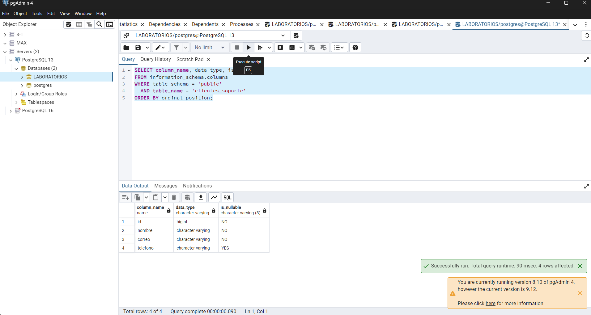

Evidencia 11 — Matriz de gobierno de datos

## Objetivo
Organicé los principales datos del cliente para mostrar qué área podría usarlos y qué protección necesitan.

## Procedimiento
Para cada dato anoté una finalidad, un responsable funcional, los usuarios que podrían necesitarlo y qué hacer cuando ya no sea necesario. Es una propuesta para el escenario del laboratorio.

## Resultado

| Dato | Finalidad | Responsable | Usuarios autorizados | Protección | Retención | Acción al finalizar |
|---|---|---|---|---|---|---|
| nombre | Atención y facturación | Atención o facturación, según el proceso | Solo personal de esas áreas que lo necesite | Permisos por rol y registro de cambios | Mientras se necesite para la relación y obligaciones aplicables | Eliminar o disociar con autorización |
| correo | Contactar al cliente | Atención | Atención; marketing solo si se aprueba el uso | Limitar consultas y exportaciones | Mientras haga falta para el contacto | Actualizar o dejar de usar según la instrucción |
| telefono | Contactar por teléfono | Atención | Personal que atiende por ese medio | Acceso limitado | Mientras sea necesario | Eliminar si ya no se necesita |
| rfc | Facturación | Facturación | Personal autorizado de facturación | Acceso restringido y auditoría | Según el plazo definido por la empresa | Disponerlo de acuerdo con la instrucción aprobada |
| edad | Estadísticas por grupo | Analítica | Analítica mediante rangos o agregados | Evitar mostrar edad exacta si no hace falta | Edad exacta solo mientras sea necesaria | Convertir a agregado o retirar el detalle |
| ciudad | Atención o estadísticas | Atención y analítica según finalidad | Atención cuando lo necesite; analítica con resultados agregados | Vistas separadas por finalidad | Mientras se use para servicio | Conservar agregados o eliminar el detalle |
| codigo_postal | Entrega o estadísticas regionales | Operaciones y analítica | Operaciones si requiere el detalle; analítica con región | Generalizar para análisis y limitar accesos | Detalle solo mientras haga falta | Reducir a región o eliminar |

## Análisis
Entiendo que el área dueña del proceso decide para qué necesita los datos. El DBA se encarga de implementar controles como roles, permisos y vistas, siguiendo esas decisiones. No todos los datos deben estar disponibles para todos los empleados.

## Conclusión
Esta matriz ayuda a relacionar cada dato con una finalidad y con las personas que lo necesitan. También sirve para revisar si todavía hace falta conservarlo.

