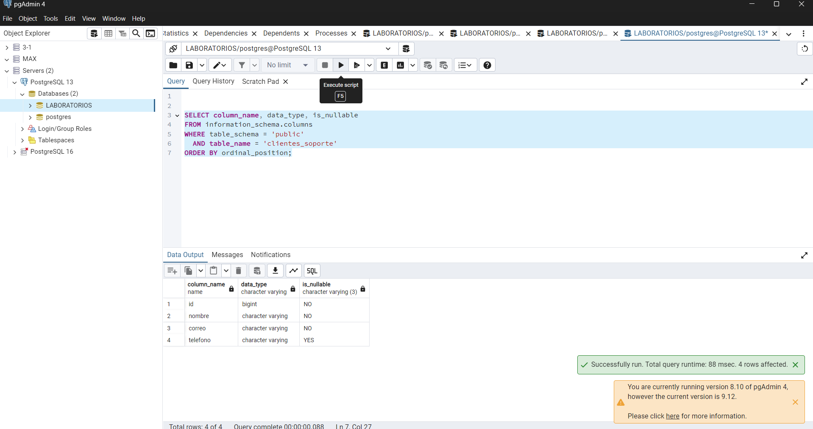

Evidencia 12 — Privacidad por diseño

## Objetivo
Revisé el diseño de una tabla que propone guardar muchos datos de los clientes “por si acaso”.

## Procedimiento
Comparé los campos propuestos con las necesidades del escenario y pensé cuáles deberían quedar desde el inicio y cuáles necesitan una justificación.

## Resultado y análisis
El problema principal es que no se explica para qué sirve cada campo. Además, juntar datos de contacto, fiscales, económicos y personales en una sola tabla puede hacer que más usuarios vean información de la que necesitan.

El principio que se está dejando de lado es la minimización. También se relaciona con la privacidad por defecto, porque el diseño propone guardar todos los campos antes de comprobar si son necesarios.

Antes de aprobarlo preguntaría: ¿qué proceso necesita cada dato?, ¿hay una alternativa menos detallada?, ¿quién lo consultará?, ¿por cuánto tiempo se guardará?, ¿se compartirá con alguien más?, ¿cómo se atenderán correcciones o solicitudes de cancelación?

Para la atención básica del escenario dejaría solamente los campos que necesita soporte: identificador, nombre, correo y teléfono si se usa. El RFC podría hacer falta para facturación. La dirección o código postal podrían hacer falta para una entrega. Edad, fecha de nacimiento, ocupación, salario y estado civil necesitarían una razón clara antes de recopilarse.

Como privacidad por defecto, empezaría con menos columnas, permisos restringidos y vistas distintas para cada área. Para desarrollo usaría datos ficticios o transformados en lugar de copias completas con datos reales.

## Conclusión
Primero se debe definir la finalidad y después decidir qué información guardar. Guardar datos “por si acaso” aumenta lo que la empresa tiene que proteger y justificar.

