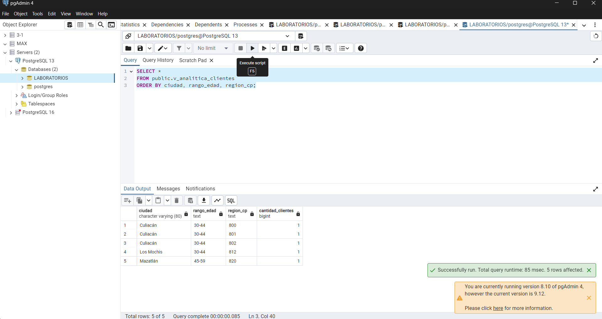
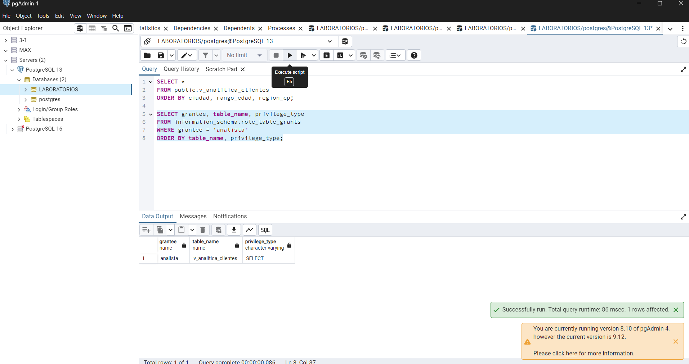

Evidencia 14 — Evaluación integral

## Objetivo
Identifiqué problemas del escenario de la empresa y propuse un control para cada uno.

## Procedimiento
Revisé los hechos del caso: analítica tiene acceso directo a la tabla completa, los datos llevan 12 años guardados, se entregan copias reales a desarrollo y marketing usa correos para promociones.

## Resultado

| Problema | Principio afectado | Riesgo | Control que propongo |
|---|---|---|---|
| Analítica consulta toda la tabla | Minimización y mínimo privilegio | Puede ver datos que no necesita | Dar acceso a una vista con información agregada |
| Analítica ve nombres, correos, teléfonos y RFC | Limitación de finalidad | Los datos pueden usarse para identificar o contactar personas | Quitar esos campos del acceso de analítica |
| Los datos se conservan por 12 años sin revisión | Retención y necesidad | Se acumula información que podría estar obsoleta | Definir plazos por finalidad y revisarlos |
| No hay política de retención | Gobierno de datos | Cada área puede decidir de manera distinta | Documentar plazos, responsables y proceso de disposición |
| Desarrollo recibe copias completas | Minimización | Más personas y sistemas quedan expuestos | Usar datos sintéticos o enmascarados |
| Las copias de prueba contienen datos reales | Privacidad por defecto y seguridad | Un incidente en pruebas podría revelar datos reales | Preparar conjuntos ficticios o transformados |
| Marketing utiliza correos para promociones sin finalidad documentada | Limitación de finalidad | Uso no esperado por los clientes | Revisar y aprobar la finalidad antes de usar los correos |
| No está claro para qué se usa cada dato | Gobierno y transparencia | No se puede justificar por qué se recopila o conserva | Crear un inventario con finalidad y responsable |
| Analítica ve códigos postales completos | Minimización | La combinación puede facilitar identificar a alguien | Usar una región más general |
| No se describen límites para exportar datos | Confidencialidad y trazabilidad | Pueden quedar copias fuera de control | Limitar exportaciones y registrar accesos |
| No se explica cómo atender solicitudes ARCO | Atención de derechos y gobierno | La búsqueda de datos puede quedar incompleta | Definir un proceso y responsables |
| No se sabe qué pasa con respaldos y réplicas | Ciclo de vida | Los datos pueden seguir existiendo tras una cancelación | Inventariar copias y definir su tratamiento |
| No se revisan los permisos periódicamente | Mínimo privilegio | Empleados pueden conservar accesos que ya no necesitan | Revisar roles y permisos con frecuencia |
| No se separan datos operativos y analíticos | Separación de finalidades | Analítica puede usar información identificable | Separar accesos y preparar datos agregados |

## Análisis
Veo que varios problemas están relacionados entre sí. Por ejemplo, dar acceso completo a analítica y entregar copias reales a desarrollo aumenta la exposición. Una vista agregada, datos ficticios y una revisión de permisos ayudarían a reducir esos riesgos.

## Conclusión
La empresa debería comenzar por limitar el acceso de analítica, evitar copias reales en desarrollo y documentar para qué se usan y cuánto tiempo se conservan los datos. Las decisiones de finalidad y retención deben revisarse con las áreas responsables.

