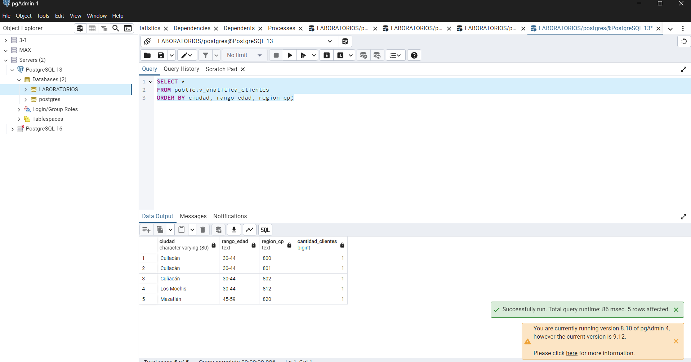

# Evidencia 15 — Propuesta de arquitectura

## Objetivo
Propuse una forma de separar los datos para que cada área use solo lo que necesita.

## Procedimiento
Tomé las áreas del escenario —atención, facturación, analítica y administración de la base— y anoté qué tipo de datos y controles usaría para cada una.

## Resultado

```text
                  Catálogo de datos y responsables
                                │
Solicitud del cliente ──> Proceso de atención de solicitudes
                                │
                     Base operativa controlada
                     ├── Atención: nombre y contacto necesario
                     ├── Facturación: datos fiscales necesarios
                     ├── Analítica: datos agregados
                     └── Auditoría: registro de cambios y accesos
                                │
                    respaldos, réplicas y copias
                    con reglas para su conservación
```

### Controles que propongo
- **Acceso:** cada área tendría permisos de acuerdo con su trabajo. Analítica consultaría una vista agregada.
- **Minimización:** solo se guardarían los campos que tengan una finalidad definida.
- **Protección:** los datos fiscales y de contacto tendrían acceso limitado; también se controlarían las exportaciones.
- **Retención:** cada categoría tendría un plazo documentado y aprobado por las áreas responsables.
- **Trazabilidad:** se registrarían cambios y accesos importantes, indicando quién los realizó y cuándo.
- **Eliminación:** antes de dar por terminada una cancelación, se revisarían la tabla principal, respaldos, réplicas, reportes y archivos exportados.
- **Solicitudes:** se usaría un proceso para recibir la solicitud, localizar los datos y dejar constancia de las acciones.
- **Pruebas:** usaría datos ficticios o transformados para desarrollo, no copias completas de datos reales.

## Análisis
La separación por áreas ayuda a reducir la cantidad de información que cada persona puede consultar. Algunas medidas se hacen en PostgreSQL, como los roles y las vistas; otras, como aprobar finalidades y plazos, requieren decisiones de la organización.

## Conclusión
La arquitectura propuesta busca que los datos se usen solo para las tareas necesarias y que también se controlen las copias. El DBA puede implementar medidas técnicas, pero necesita instrucciones y decisiones de las áreas responsables.



